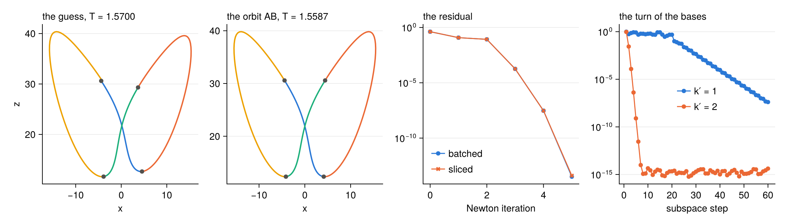
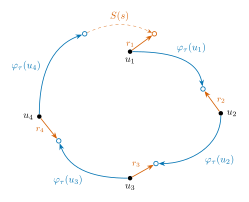
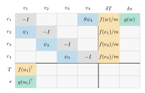
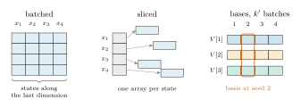
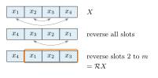
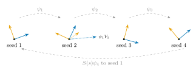
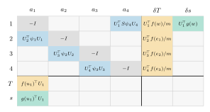
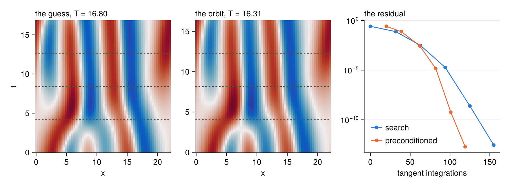
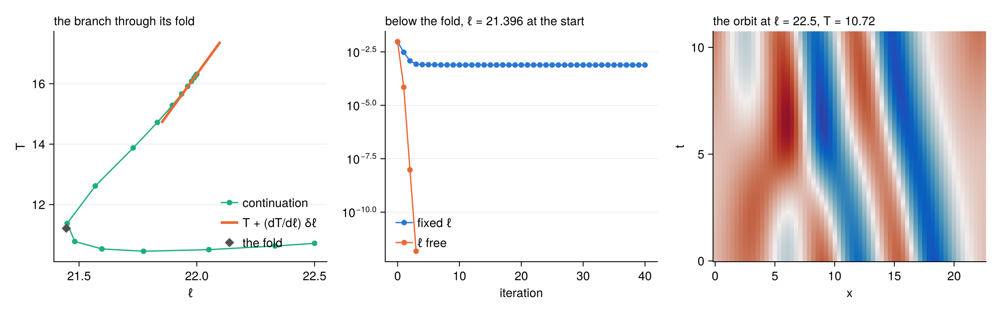

<p align="center">
  
</p>

# MultipleShooting.jl

Periodic and relative periodic orbits by multiple shooting, matrix free, in Julia. The orbit is cut
into segments of equal length. The package builds the residual of the segments and the product of
its Jacobian with a vector, and the Newton–Krylov hookstep of
[NKRoots.jl](https://github.com/Davide-Lasagna-s-Lab/NKRoots.jl) solves the equations. The
dynamics are objects of your own, called on batches of states: all the segments are advanced
together, on threads, on a GPU, or one after the other.

The package has four parts, and this page follows them.

- **The interface.** The seeds, an array whose last dimension runs over the states, a vector of
  states, or a type of your own; and the dynamics, callable objects that advance a whole batch.
- **The search.** The residual, its Jacobian with the phase conditions, and `nkroot!` of NKRoots.jl
  on top (Sánchez et al. 2004; Sánchez & Net 2010).
- **The preconditioner.** Bases of the leading tangent directions, carried along the loop by
  subspace iteration (Lust 1997), and the preconditioner of Sánchez & Net (2010) on them, which
  solves exactly in their span.
- **The parameter.** The derivative of an orbit in a parameter of the equation, the search with
  the parameter free, and the continuation of an orbit through the folds of its branch.

Three examples run through the page, the Lorenz system, the Kuramoto–Sivashinsky equation, and the
branch of one of its orbits in the length of the domain, and a guide to the code closes it. The method and its analysis are those of Lasagna, Ashtari, Burton & Schneider (2026).

**Contents.**
[Installation](#installation) ·
[A first search](#a-first-search) ·
[Multiple shooting](#multiple-shooting) ·
[The interface](#the-interface) ·
[Batches, threads and GPUs](#batches-threads-and-gpus) ·
[The search](#the-search) ·
[Subspace iteration and the preconditioner](#subspace-iteration-and-the-preconditioner) ·
[Kuramoto–Sivashinsky](#kuramotosivashinsky-at-l--22) ·
[The parameter](#the-parameter) ·
[A guide to the code](#a-guide-to-the-code) ·
[Tests](#tests) ·
[References](#references)

## Installation

The package and NKRoots.jl are not registered. The package finds NKRoots.jl in a checkout next to
its own, `../NKRoots.jl`:

```
git clone https://github.com/Davide-Lasagna-s-Lab/NKRoots.jl
git clone https://github.com/Davide-Lasagna-s-Lab/MultipleShooting.jl
julia -e 'using Pkg; Pkg.develop(path="MultipleShooting.jl")'
```

Each example is a folder of `examples/`, with its script and the figure that the script writes.
The examples share one environment, `examples/Project.toml`, with
[Flows.jl](https://github.com/Davide-Lasagna-s-Lab/Flows.jl) for the time stepping, from a
checkout next to this repository, and CairoMakie for the figures. Every number and figure on this
page comes from one of them. A script is run from the root of the repository:

```
git clone https://github.com/Davide-Lasagna-s-Lab/Flows.jl ../Flows.jl
julia --project=examples -e 'using Pkg; Pkg.instantiate()'
julia --project=examples examples/lorenz/lorenz.jl
```

## A first search

The orbit AB of the Lorenz system at $\sigma = 10$, $\rho = 28$, $\beta = 8/3$, from four seeds of
a near recurrence, in [`examples/lorenz/lorenz.jl`](examples/lorenz/lorenz.jl). The seeds are a
$3 \times 4$ matrix, one state per column, with the period after them:

```julia
guess = ShootingVector([-4.3916429753   4.5595009656   3.6883670592  -3.8671374687;
                         2.1325664921   7.9944849552  -1.9178392035  -6.9073223838;
                        30.6127436095  12.6485708665  29.3130502493  11.6370396562], [1.57])
```

The dynamics are one type, with the role of each object in its parameter `R`, and each object
advances all the columns of a matrix at once. `advance!` runs the RK4 of Flows.jl, alone or
coupled with the tangent equation, whose stages are those of the scheme linearised, so that the
tangent is the derivative of the scheme:

```julia
struct Lorenz{R}
     ρ::Float64 # the parameter
    dt::Float64 # the largest time step
end

(G::Lorenz{:G})(X::Batched, τ::Real)             = advance!(rhs(G.ρ), X, τ, G.dt)
(L::Lorenz{:L})(X::Batched, V::Batched, τ::Real) = advance!(rhs(L.ρ), tangent(L.ρ), X, V, τ, L.dt)
(F::Lorenz{:F})(dX::Batched, X::Batched)         = rhs(F.ρ)(0.0, X, dX)
```

The flow `G` makes the residual, the tangent `L` and the right-hand side `F` its Jacobian, and
`nkroot!` of NKRoots.jl overwrites the guess with the orbit:

```julia
D = lorenz(28.0)        # (G, L, F, Lp, dG) at ρ = 28
z = copy(guess)
nkroot!(Residual(D.G), Jacobian(D.L, D.F, z; D.dG), z; krylov_dim=20, krylov_tol=1e-10, Δ=1.0,
        tol=1e-12)
```

It converges in five iterations to $T = 1.5586522109$. The derivative of the flow in $\tau$, `dG`,
gives the column of the period of the scheme, so that the Jacobian is exact for the discrete
residual and the last iterations converge quadratically. The same seeds as a vector of 3-vectors,
`Sliced(collect.(eachcol(guess.X)))`, with methods that advance one state at a time, give the same
orbit in the same iterations. The forced tangent `Lp` gives the derivative of the orbit in $\rho$,

```julia
dz = tangent_sensitivity(D.L, D.Lp, D.F, z; D.dG)
```

with $dT/d\rho = -0.03925282$, as central differences of the period of the orbits at
$\rho = 28 \pm 10^{-4}$. The last panel is the subspace iteration on the orbit, with one direction
at every seed and with two, the unstable and the neutral ones (see
[below](#subspace-iteration-and-the-preconditioner)).



## Multiple shooting

A system $\dot u = f(u)$ with the flow $\varphi_t$ may have $c \geq 0$ continuous symmetries, the
shifts $S(s) = \exp(\sum_j s_j T_j)$, $s \in \mathbb{R}^c$, generated by commuting linear operators
$T_j$, which commute with the flow. A relative periodic orbit of period $T$ and shift $s$ passes
through the states with

$$
S(s)\,\varphi_T(u) = u,
$$

and with $c = 0$ it is a periodic orbit. Multiple shooting cuts it into $m$ segments of length
$\tau = T/m$, from the seeds $u_1, \dots, u_m$, so that every equation spans a time $\tau$ only and
the growth of the errors along a segment stays within the arithmetic, however long the orbit. The
unknowns and the residual are

$$
z = (u_1, \dots, u_m, T, s_1, \dots, s_c), \qquad
r_{i+1} = \varphi_\tau(u_i) - u_{i+1}, \quad
r_1 = S(s)\,\varphi_\tau(u_m) - u_1 .
$$



*The loop with $m = 4$. Each seed (black) is advanced by $\tau$ to the end of its segment (open
circles), the end of the last is shifted by $S(s)$, and the residual $r_{i+1}$ is the gap between
the end of segment $i$ and the next seed.*

The equation of segment $i$ sits in the row of seed $i + 1$. The Jacobian is then $-I$ on the
seeds, the tangent maps $\psi_i = D\varphi_\tau(u_i)$ on a cyclic block subdiagonal, and the
columns of the period and of the shifts,

$$
(Jv)_{i+1} = \psi_i v_i - v_{i+1} + \frac{\delta T}{m}\,\partial_\tau \varphi_\tau(u_i), \qquad
(Jv)_1 = S(s)\,\psi_m v_m - v_1 + \frac{\delta T}{m}\,S(s)\,\partial_\tau \varphi_\tau(u_m)
         + \sum_j \delta s_j\, g_j(w),
$$

with $w = S(s)\varphi_\tau(u_m)$ and $g_j(x) = T_j x$ the generator of shift $j$. An orbit is not
isolated: its seeds advanced by any time, or shifted, are an orbit too, and the Jacobian has the
null directions $(f(u_1), \dots, f(u_m), 0, 0)$ and $(g_j(u_1), \dots, g_j(u_m), 0, 0)$. The phase
conditions, the last rows,

$$
(Jv)_T = \langle f(u_1), v_1 \rangle, \qquad (Jv)_{s_j} = \langle g_j(u_1), v_1 \rangle,
$$

exclude them from the Newton step, which is then orthogonal at the first seed to the time
derivative and to the generators. They act on the step, not on the point, so that the scalar part
of the residual is zero. $J$ is square, of $mn + 1 + c$ rows for states of dimension $n$.



*The blocks of the Jacobian for $m = 4$ and one shift, with $e_i = \varphi_\tau(u_i)$ the end of
segment $i$ and $S = S(s)$. Blank blocks are zero; the last two rows are the phase conditions.*

The tangent maps are never formed (Sánchez et al. 2004). A product $Jv$ integrates the seeds again
with the vector $v$, all the segments in one call of the tangent, at the cost of one tangent
integration of the whole orbit, with no trajectory stored. The column of the period is $f$ at the
end points by default, the derivative of the continuous flow in $\tau$. It differs from that of
the time-stepping scheme by the error of the scheme, and the last Newton iterations then converge
linearly, at a rate of the size of that error. A flow that gives the derivative of its own scheme
in $\tau$, `dG`, makes the Jacobian exact for the discrete residual. For a Runge–Kutta scheme with
a fixed number of steps, which sees $\tau$ only in the products of its steps with $f$, this is the
tangent equation forced by $f/\tau$, from zero, as `dG` in the Lorenz example.

## The interface

Two things come from you: the seeds, and the dynamics.

### The seeds

`z = ShootingVector(X, [T, s₁, …])` holds the seeds `X`, $m$ states, and the period followed by one
shift per symmetry, `[T]` for a periodic orbit. `period(z)`, `shift(z, j)` and `nshifts(z)` read
them. It is the vector of the Krylov method of NKRoots.jl: it broadcasts, `w .= α .* z .+ w`, as
one broadcast on the seeds and one on the scalars, and its inner product is the sum of those of the
states and of the scalars, with no weight between them. The seeds may be

- **an array of numbers**, a `Batched`, with the states along its last dimension: the columns of a
  matrix, the slices of a three-dimensional array, on the CPU or on a GPU. Nothing is wrapped: an
  array is seeds as it is. The inner product is the Euclidean one, its real part for complex
  states;
- **a `Sliced`**, `Sliced(states; dot)`, a vector of states, each an array of any shape, with the
  Euclidean inner product or one of your choice;
- **a type of your own**, with the functions below.



*Batched, the states are the slices of one array along its last dimension. Sliced, each state is an
array of its own. The bases of the subspace iteration are $k'$ batches like the seeds, one per
direction, and the basis at a seed gathers that seed from every batch.*

The package moves the states only through these functions, and through `similar`, `copy`,
`copyto!`, `Random.randn!` and broadcasting:

```
nsegments(X)              the number of states
states(X, r)              the states r, as an X that shares them; head(X) and tail(X) are the
                          first and the last
similar_states(X, b)      an X of b states, its entries not set
roll_forward!(X)          (x₁, …, x_m) → (x_m, x₁, …, x_{m-1}), in place
roll_backward!(X)         its inverse
dots(X, Y)                the inner products of the states one by one, real, in a form that
                          broadcasts against X
coefficients(X, c)        a vector c of m numbers in the same form, so that c .* X scales each state
LinearAlgebra.dot(X, Y)   the inner product, the sum of dots
```

The inner product of the states is the one of `dots`, and GMRES, the phase conditions, the bases
and the preconditioner all use it, so that they share one geometry. The batches of vorticity fields
of BatchedKolmogorovFlow.jl are a type of this kind, on a GPU, with the weighted inner product of
the fields.

### The dynamics

Callable objects, each with one task, which it does in place on all the states of a batch. The
package uses no value they return.

| call | task | taken by |
|---|---|---|
| `G(X, τ)` | the flow: every state of `X` advanced by `τ` | `Residual`, `JacobianFD`, the parameter |
| `L(X, V, τ)` | the tangent: `X` advanced, and `V` by the tangent equation along it; `V` a batch like `X`, or a vector of $k'$ of them | `Jacobian` (a batch), `Subspace` and `Preconditioner` (a vector) |
| `F(dX, X)` | the right-hand side $f$ at every state | `Jacobian`, `JacobianFD`, `Preconditioner` |
| `S(X, s...)` | every state shifted by $S(s)$, one number per shift | relative periodic orbits |
| `dS(dX, X, j)` | the generator $g_j$ of shift `j` at every state | relative periodic orbits |
| `Lp(X, V, τ)` | as `L`, with the tangent equation forced by $\partial f/\partial p$ | `tangent_sensitivity`, the parameter |
| `dG(X, V, τ)` | `X` advanced, and `V` the derivative in `τ` of the end points | `Jacobian`, optional |

Each part takes only the objects it calls:

```julia
Residual(G; S)
Jacobian(L, F, z; S, dS, dG)
JacobianFD(G, F, z; S, dS)
Subspace(L, z; k′, S)
Preconditioner(L, F, z; k′, S, dS)
tangent_sensitivity(L, Lp, F, z; S, dS, dG)
freesearch!(family, G, L, F, z, p; Lp, S, dS, dG, precond)
continuation!(family, G, L, F, z, p; Lp, S, dS, dG, precond)
```

An object can then hold the arrays of its own task, made once for the batches it will see: $m$
states for `G` and `F`, $m$ states with one direction each for the `L` of the Jacobian, and with
$k'$ each for the `L` of the preconditioner. One object may also play several roles, as the shift
and its generator in the Kuramoto–Sivashinsky example. A tangent called with $k'$ directions should
advance the states once for all of them: a subspace step then costs one integration of the
equation and $k'$ of its tangent. The shifts must commute with the flow,
$f(S(s)x) = S(s)f(x)$. The tangent is best the derivative of the scheme, as above, which makes the
Jacobian that of the discrete residual (Sánchez et al. 2004).

## Batches, threads and GPUs

The package never advances a state on its own. Every integration is one call of an object on a
whole batch: the seeds for the residual, the seeds with one vector for a product of the Jacobian,
the seeds with $k'$ vectors for a subspace step. How a batch is advanced, all at once on a GPU,
chunk by chunk on threads, or state by state, is the choice of the object. Everything else is
broadcasting on the seeds and inner products by `dots`, so that it runs where the seeds live.

**Batched seeds on a GPU.** With seeds that are an array on a GPU, a `CuArray` or a type of your
own, the Krylov basis, the bases of the subspace iteration and every work batch are on the device,
made by `similar`. A batch may fill a large part of its memory, so that no step needs a second one:
the residual is computed in place in one batch, and the roll that moves each end point into the row
of the seed it has to reach is made by two reversals along the last dimension, in place.



*The roll by two reversals: all the slots, then slots $2$ to $m$ (frame). Each state ends in the
slot after its own, the last in slot 1, and no second batch is made.*

What crosses to the host is small. An inner product is a reduction on the device: `dots` gives $m$
numbers, and the Krylov method and the phase conditions take sums of them. The subspace iteration
brings to the host the $k' \times k'$ matrices of inner products of each seed, and the
preconditioner solves its coarse system, of size $mk' + 1 + c$, on the host, and sends back $k'$
vectors of $m$ coefficients by `coefficients`. The seeds are never copied to the host.

**Sliced seeds.** A vector of states, for states of different shapes, or for a flow that advances
one state at a time, on threads if the object spreads them. The roll permutes the references to the
states and moves no data, and broadcasting runs state by state.

**Threads.** An object may cut a batch into chunks and advance each on its own thread, as the
propagators of BatchedKolmogorovFlow.jl do: the package sees one call on the whole batch either way.

## The search

The residual and the Jacobian are what `nkroot!` of NKRoots.jl needs, which solves $R(z) = 0$ by
Newton–Krylov with the hookstep of Viswanath (2007):

```julia
R = Residual(G; S, bounds=(0.5T, 2T))           # r = R(z), one integration of the seeds
J = Jacobian(L, F, z; S, dS)                    # J v, one tangent integration per product
nkroot!(R, J, z; krylov_dim=60, krylov_tol=1e-8, Δ=1.0, tol=1e-10)
```

- `Residual(G; S, bounds)` advances the seeds in place in the batch of the residual, shifts the
  last, rolls and subtracts. A period outside `bounds` gives an infinite residual with no
  integration, which the search refuses as any step that does not lower the residual: a full
  Newton step can take the period below zero, where no segment exists.
- `Jacobian(L, F, z; S, dS, dG)`. `update!(J, z)`, which `nkroot!` calls at every iteration, moves
  it to the new point with one integration of the seeds: the end points of the segments, the column
  of the period, and $f$ and the generators at the first seed. Each product `mul!(out, J, v)` then
  integrates the seeds with $v$ once more.
- `JacobianFD(G, F, z; S, dS)` is the same product by a finite difference of the residual, with the
  same phase rows, for a system with no tangent: one integration per product, or two for a central
  difference.

What a Newton iteration of `nkroot!` calls, in integrations of the whole orbit, each a time $T$ in
all:

| step | calls | integrations |
|---|---|---|
| `update!(J, z)` | `L` from $V = 0$, or `dG`; `F`; `dS` at the first seed | 1 |
| `update!(M, z)`, with a preconditioner | the subspace steps, `L` with $k'$ directions each | $k'$ per step |
| an iteration of GMRES | `mul!(out, J, v)`: `L` once; `ldiv!(out, M, v)`: none | 1 |
| a trial step | `R(r, z)`: `G` once | 1 |

## Subspace iteration and the preconditioner

The tangent maps round the loop stretch a few directions, keep the time derivative and the
generators, and contract the rest. An eigenvector $x = (x_1, \dots, x_m)$ of the block of $J$ on
the seeds, with eigenvalue $\zeta$, has $M_1 x_1 = (1 + \zeta)^m x_1$, with
$M_1 = S(s)\psi_m \cdots \psi_1$ the monodromy of the loop: every Floquet multiplier $\Lambda_j$
gives $m$ eigenvalues on the circle $|1 + \zeta| = |\Lambda_j|^{1/m}$ about $-1$. The circles of the
unstable and neutral multipliers enclose the origin or pass through it, and GMRES needs about $m$
iterations for each of them (Sánchez & Net 2010). The preconditioner takes them away.

**The bases.** `Subspace(L, z; k′, S)` keeps an orthonormal basis $V_i$ of $k'$ directions at every
seed, random at the start. A step, `iterate!(S)`, carries every basis over its segment and
orthonormalises the images at the next seed,

$$
\psi_i V_i = V_{i+1}' R_i, \quad i = 1, \dots, m - 1, \qquad S(s)\,\psi_m V_m = V_1' R_m,
$$

by two passes of modified Gram–Schmidt across the $k'$ batches, seed by seed, with $R_i$ upper
triangular and $V'$ the new bases. This is the subspace iteration of the Newton–Picard method
(Lust 1997; Lust et al. 1998; Saad 2011), with one difference: in Lust's sweep one basis goes round
the loop segment after segment, while here every seed carries its own over its own segment, all at
once, as the products of the Jacobian go. After $m$ steps every seed has run one step of the
subspace iteration with its own monodromy.



*A subspace step with $k' = 2$. Every basis is carried over its segment, the last shifted back to
the first seed, and orthonormalised where it lands, all seeds at once. At seed 2 the dotted frame
is the image of the basis of seed 1.*

**The test.** `maxturn(S; k)` is how far the span turned in the last step: the sine of the $k$-th
smallest principal angle between the spans before and after it, the largest over the seeds. Once
the span holds the $k$ leading directions, it vanishes, whatever the other $k' - k$ directions, the
guard vectors, do; it falls by about $e^{-(\lambda_k - \lambda_{k'+1})\tau}$ per step, with
$\lambda_j$ the Floquet exponents, so that the guard vectors speed it up. The bases pass the test of
Lasagna et al. (2026) when it falls below a tolerance. In the Lorenz example, the unstable and the
neutral directions together settle to rounding in seven steps, while the unstable one alone, set
apart from the neutral one by a factor of 4.7 over a loop, falls slowly, to $10^{-7}$ in sixty.

**The preconditioner.** With the bases $U_i$ of the seeds,

$$
W = \mathrm{blockdiag}(U_1, \dots, U_m, I_{1+c}), \qquad E = W^\top J W, \qquad
M^{-1} = -(I - WW^\top) + W E^{-1} W^\top,
$$

$-I$, the inverse of the diagonal of $J$, outside the span of $W$, and an exact solve with $E$ in
it: the preconditioner of Sánchez & Net (2010), in the spirit of the Newton–Picard splitting. When
the spans are invariant, $J M^{-1} W = W$, and the directions of the bases reach GMRES at one. $E$
needs no integration of its own: its blocks below the diagonal are the Galerkin blocks
$U_{i+1}^\top \psi_i U_i$ of the subspace step, and its columns of the period and of the shifts come
from the end points that the step leaves. It is sparse, of $mk' + 1 + c$ rows, and factorised by
sparse QR on the host.



*The blocks of $E = W^\top J W$ for $m = 4$ and one shift. The columns hold the coordinates $a_i$
of the seeds in their bases, then the period and the shift; all the blocks come from one subspace
step.*

`Preconditioner(L, F, z; k′, S, dS, k, tol, maxsteps, sweeps, cap, every)` builds it, and
`nkroot!(R, J, z; precond=M)` moves it to every new point, `update!(M, z)`, with subspace steps
from the bases of the point before. The keywords give the three ways of keeping the bases up of
Lasagna et al. (2026):

| way | keywords | at every Newton step |
|---|---|---|
| frozen | `every = 0` | nothing: the bases and $E$ of the first step |
| fixed steps | `tol = 0`, `maxsteps = n`, `cap = :keep` | $n$ subspace steps |
| to a tolerance | `tol = ε` | steps until `maxturn(S; k) ≤ ε`, at most `maxsteps` |

`sweeps` makes steps from the random bases when it is built. With `flexible = true` NKRoots.jl keeps
the preconditioned vectors; with `flexible = false` it needs the lengths of the vectors
$M^{-1} q_j$ for the trust region, which `gram(M, Q)` gives from their coefficients alone, with no
product.

## Kuramoto–Sivashinsky at L = 22

[`examples/ks/ks.jl`](examples/ks/ks.jl) finds the shortest relative periodic orbit of
$u_t = -u u_x - u_{xx} - u_{xxxx}$ on $[0, \ell)$, $\ell = 22$, that of Cvitanović, Davidchack &
Siminos (2010), from four seeds of a near recurrence, with and without the preconditioner. The
equation and the objects of its dynamics are in [`examples/ks/dynamics.jl`](examples/ks/dynamics.jl),
which the example of [the parameter](#the-parameter) shares. The equation is written on
$\tilde x = 2\pi x/\ell \in [0, 2\pi)$, for the Fourier coefficients $\hat u_k$ of the modes
$k = 1, \dots, 21$,

$$
\hat u_t = (\kappa^2 - \kappa^4)\,\hat u - \frac{i\kappa}{2}\,\widehat{u^2}, \qquad
\kappa = \frac{2\pi k}{\ell},
$$

the last mode below $N/3$ on a grid of $N = 64$ points, so that the products have no aliasing and
the shift by $\tilde s$ along $\tilde x$, $\hat u_k \to e^{ik\tilde s}\hat u_k$, commutes with the
truncated flow exactly. On $\tilde x$ the shift does not depend on $\ell$, which enters the
equation alone; the shift along $x$ is $s = \tilde s\,\ell/2\pi$. A batch is a $21 \times m$
complex matrix, one state per column: seeds that need no code.

The steps are those of CB3R2R3e of Flows.jl, with the linear part implicit. Each object holds its
flow, made once for the batches it advances. The tangent couples the states with $k'$ batches of
perturbations side by side, a $21 \times k'm$ matrix, so that all the directions go with the states
in one integration:

```julia
# the flow G(X, τ), made once for batches of m states
(G::Flow)(X::Matrix{ComplexF64}, τ::Real) = (G.ϕ(X, (0, τ)); X)

# the tangent L(X, V, τ), V a vector of k′ batches like X
function (P::Tangent)(X::Matrix{ComplexF64}, V::AbstractVector{<:Matrix{ComplexF64}}, τ::Real)
    Y, W    = P.Z[1], P.Z[2]                      # the states, and the perturbations side by side
    cols(a) = ((a - 1)*P.m + 1):(a*P.m)
    Y .= X
    for a in 1:P.k′
        view(W, :, cols(a)) .= V[a]
    end
    P.ϕ(P.Z, (0, τ))                              # advanced together, the states once
    X .= Y
    for a in 1:P.k′
        V[a] .= view(W, :, cols(a))
    end
    return V
end

(P::Tangent)(X::Matrix{ComplexF64}, V::Matrix{ComplexF64}, τ::Real) = (P(X, [V], τ); V)

# the shift S(X, s̃) along x̃ and its generator dS(dX, X, j): one object in two roles
(S::Shift)(X, s::Real)    = (X .*= cis.(S.k .* s); X)
(S::Shift)(dX, X, j::Int) = (dX .= im .* S.k .* X; dX)
```

`ks(ℓ)` makes them all, with three tangents: `L`, one direction, for the Jacobian, `Lk`, four,
for the preconditioner, and `Lp`, forced by $\partial f/\partial\ell$, for the parameter. The
search, and the same preconditioned on bases of four directions, with one subspace step per Newton
step:

```julia
D = ks(22.0)
R = Residual(D.G; D.S)

z = copy(GUESS)
nkroot!(R, Jacobian(D.L, D.F, z; D.S, D.dS), z; krylov_dim=60, krylov_tol=1e-8, Δ=1.0, tol=1e-10)

w = copy(GUESS)
M = Preconditioner(D.Lk, D.F, w; k′=4, D.S, D.dS, sweeps=5, tol=0.0, maxsteps=1, cap=:keep)
nkroot!(R, Jacobian(D.L, D.F, w; D.S, D.dS), w; precond=M, flexible=true, krylov_dim=60,
        krylov_tol=1e-8, Δ=1.0, tol=1e-10)
```

```
search:                 converged in 5 iterations, 155 products, T = 16.3147, s = -2.8634
preconditioned search:  converged in 5 iterations,  79 products, T = 16.3147, s = -2.8634
tangent integrations:   155 without the preconditioner, 119 with it
```

The orbit is that of Cvitanović et al., with the shift of its symmetric partner. The preconditioned
search takes 79 products instead of 155, and 119 tangent integrations of the orbit with its
subspace steps, four each. On an orbit this short the gain is modest. It grows with the period:
without the preconditioner the iterations of GMRES grow with the number of segments, with it they
do not (Lasagna et al. 2026).



## The parameter

When the right-hand side depends on a parameter, $f(u; p)$, the orbits lie on branches, curves of
the points $x = (z, p)$ with $R(z, p) = 0$. The objects depend on $p$ through a function of yours,
`family(x, p)`, which gives the object `x` at the parameter `p`; an object that does not depend on
it is returned as it is. Three tools work on a branch: the derivative of an orbit along it, the
search with $p$ free, and the continuation. All three need the column

$$
c = \frac{\partial R}{\partial p}, \qquad
c_{i+1} = y_i(\tau), \quad c_1 = S(s)\,y_m(\tau), \qquad
\dot y_i = Df(\varphi_t(u_i))\,y_i + \frac{\partial f}{\partial p}(\varphi_t(u_i)), \quad
y_i(0) = 0,
$$

with zeros on the phase rows. The forced tangent `Lp` gives it in one integration of the seeds,
when the shifts do not depend on $p$; the searches can also take a central difference of the
residual in $p$, two integrations, whatever $p$ enters.

### The sensitivity

Along a branch $R(z(p), p) = 0$, so that

$$
J\,\frac{dz}{dp} = -\frac{\partial R}{\partial p}.
$$

`tangent_sensitivity(L, Lp, F, z; S, dS, dG)` builds $J$ at the converged orbit $z$, one
integration, the column by `Lp`, one more, and solves the system by GMRES from zero, without
restarts, one product with $J$ per iteration. The derivatives of the period and of the shifts do not
depend on the phase of the orbit; those of the seeds do, and satisfy the phase conditions at $z$.
`Lp` is best the derivative of the scheme in $p$; a forcing taken as an explicit term by the scheme
gives the derivative up to the error of the scheme.

### The search with the parameter free

`freesearch!(family, G, L, F, z, p; Lp, S, dS, dG, precond)` takes $p$ as one more unknown. The
linearised equations $J\,\delta z + c\,\delta p = -R$ have one more unknown than equations, and
their solutions make a line along the null vector $n$ of $[J\;c]$, the tangent of the branch. Each
iteration takes the shortest of them, at right angles to $n$, the Newton step with the
Moore–Penrose inverse of $[J\;c]$ (Allgower & Georg 1990), from two bordered systems:

$$
\begin{bmatrix} J & c \\ t^\top \end{bmatrix} n = \begin{bmatrix} 0 \\ 1 \end{bmatrix},
\qquad
\begin{bmatrix} J & c \\ n^\top \end{bmatrix}
\begin{bmatrix} \delta z \\ \delta p \end{bmatrix} = -\begin{bmatrix} R \\ 0 \end{bmatrix},
$$

with $t$ the tangent of the iterate before, which fixes the sense of $n$, and $n$ normalised. The
bordered matrix is regular wherever $[J\;c]$ has full rank, at a fold too, where $J$ is singular
(Keller 1977). The step is halved until the squared residual falls by $10^{-3}$ of what it would
fall for a linear problem, $\mu(2 - \mu)$ for a step $\mu$. An iteration costs the move of $J$ and
of the preconditioner to the iterate, the column, and two solves by GMRES, preconditioned on the
right by `precond` on $z$ and by the identity on $p$.

The search converges, as Newton does, onto the branch near the guess, at whatever parameter it meets
it: it does not aim at a parameter. This is what it is for. Near a fold, a guess at a parameter
beyond it, where no orbit is, makes a search at fixed $p$ stall at the least residual there, the
ghost of the orbit; the search with $p$ free converges. The norm of a step weighs $\delta p$ as one
scalar of $z$, the period or a shift, so that $p$ is best scaled to a comparable size in `family`.

### The continuation

`continuation!(family, G, L, F, z, p; sense, target, step, longest, shortest, points, …)` follows
the branch from the orbit $z$ at $p$. From the point $x_k$ with unit tangent $t_k$:

1. **Predictor.** $x_k + h\,t_k$, a step of length $h$ along the tangent.
2. **Corrector.** The search with $p$ free from the predictor, at most 8 iterations, with $t_k$ in
   its first bordered system. The point is taken if the search converges and its tangent turns by
   less than $\cos^{-1} 0.7$ from $t_k$.
3. **Step.** Halved when the corrector fails, down to `shortest`, where the continuation ends;
   grown by half after a corrector of three iterations or fewer, up to `longest`.
4. **Events.** The continuation ends at the zero of $g$, the part $t_p$ of the tangent in $p$, zero
   at a fold, or $p$ less the `target`. When $g$ changes sign between two points the zero is closed
   in on the step $h$, by the secant rule with the Illinois correction, each trial a corrector from
   its predictor, to $|g|$ below $10^{-2}$ of its value at the last point for a fold, and $10^{-10}$
   for a target.

The sense of the tangent is carried through a fold by the bordering row, so that with a `target` the
branch is followed through its folds, and with none it ends at the first. The first point is a
search from $(z, p)$; when it fails the continuation ends with the status `:start`. The corrector is
the Moore–Penrose one, each step at right angles to the tangent at its own iterate: two solves an
iteration, against one for pseudo-arclength continuation, whose corrector stays on the hyperplane
through the predictor (Keller 1977). With `residual = (r, z, a) -> (R(r, z); r .-= a .* R₀)` and
`family = (x, a) -> x` the continuation follows the Newton homotopy $R(z) - a\,R(z_0) = 0$ from
$a = 1$ to the target $0$, a search for an orbit from a poor guess.

### What is not done

- Bifurcations other than folds are not detected, and there is no branch switching: the Floquet
  multipliers are not monitored along the branch, for period doubling, symmetry breaking or tori.
- A fold is located, to $10^{-2}$ of the slope, not solved as an extended system, and not followed
  in a second parameter.
- The predictor is of first order, and the step is controlled by the iterations of the corrector and
  the turn of the tangent, not by an estimate of the curvature.
- The sensitivity has no preconditioner, and needs `Lp` with shifts that do not depend on $p$.

### On Kuramoto–Sivashinsky

[`examples/parameter/parameter.jl`](examples/parameter/parameter.jl) takes the length $\ell$ of the
domain as the parameter of the orbit above. On $\tilde x$ the shift does not depend on $\ell$, and

$$
\frac{\partial f}{\partial \ell} = -\frac{1}{\ell}\Big[(2\kappa^2 - 4\kappa^4)\,\hat u
- \frac{i\kappa}{2}\,\widehat{u^2}\Big],
$$

since $d\kappa/d\ell = -\kappa/\ell$. `Lp` adds it to the explicit term of the tangent, and
`at(x, ℓ)` makes each object again at $\ell$, the shift as it is:

```julia
dz = tangent_sensitivity(D.L, D.Lp, D.F, z; D.S, D.dS)

y = copy(z)            # to the fold
continuation!(at, D.G, D.L, D.F, y, 22.0; D.Lp, D.S, D.dS, sense=-1, krylov_dim=60, periods)

x = copy(z)            # through the fold, to ℓ = 22.5
continuation!(at, D.G, D.L, D.F, x, 22.0; D.Lp, D.S, D.dS, sense=-1, target=22.5, krylov_dim=60,
              periods)

w = copy(y)            # from the orbit of the fold, at ℓ below it
freesearch!(at, D.G, D.L, D.F, w, ℓf - 0.05; D.Lp, D.S, D.dS, krylov_dim=60, krylov_tol=1e-8)
```

```
dT/dℓ:   10.726448, central differences 10.726451
ds̃/dℓ:   0.023574, central differences 0.023573
to the fold:     fold at ℓ = 21.4460 in 12 points, T = 11.2149
to the target:   target at ℓ = 22.5000 in 17 points, T = 10.7179, s = -3.4939
fixed ℓ = 21.3960:  maxiter in 40 iterations, residual 7.7e-04
ℓ free:          converged in 3 iterations, residual 1.5e-12, at ℓ = 21.4460
```

- **The sensitivity** agrees with central differences of the orbits converged at
  $\ell = 22 \pm 10^{-3}$, $dT/d\ell$ to six digits and $d\tilde s/d\ell$ to four, from one forced
  integration and one GMRES solve instead of two searches, with the forcing explicit.
- **The branch** falls steeply to smaller domains, $dT/d\ell = 10.7$, from $T = 16.31$ at
  $\ell = 22$ to $T = 11.21$ at the fold, $\ell = 21.446$, where it turns. Through the fold it
  comes back to larger domains with periods near 10.5, crosses $\ell = 22$ again, and reaches the
  target, an orbit of period 10.72 at $\ell = 22.5$.
- **Below the fold**, at $\ell = 21.396$ and from the orbit of the fold, the search at fixed
  $\ell$ stalls at the residual $7.7 \times 10^{-4}$, the ghost of the orbit. The search with
  $\ell$ free converges in three iterations, onto the fold itself, the point of the branch nearest
  the guess.



## A guide to the code

| file | what it holds |
|---|---|
| [`src/MultipleShooting.jl`](src/MultipleShooting.jl) | the module, its exports, the notation |
| [`src/interface.jl`](src/interface.jl) | the functions of the seeds, with no method, and the calls of the dynamics: what you provide |
| [`src/seeds/batched.jl`](src/seeds/batched.jl) | `Batched`, an alias of an array of numbers: the roll by two reversals, `dots` by a reduction on the device |
| [`src/seeds/sliced.jl`](src/seeds/sliced.jl) | `Sliced`, a vector of states: the roll by permuting references, broadcasting state by state |
| [`src/shootingvector.jl`](src/shootingvector.jl) | `ShootingVector`, the unknowns: broadcasting split between the seeds and the scalars, the inner product |
| [`src/residual.jl`](src/residual.jl) | `Residual`: the residual in place, the bounds on the period |
| [`src/jacobian.jl`](src/jacobian.jl) | `Jacobian`: `update!` and `mul!`, the columns of the period and of the shifts, the phase rows |
| [`src/jacobian_fd.jl`](src/jacobian_fd.jl) | `JacobianFD`: the product by the finite difference of NKRoots.jl, with the same phase rows |
| [`src/subspace.jl`](src/subspace.jl) | `Subspace`, `iterate!`, `maxturn`: the step, Gram–Schmidt across the batches, the Galerkin blocks, the turn and its test |
| [`src/preconditioner.jl`](src/preconditioner.jl) | `Preconditioner`: the coarse matrix, its sparse QR, `ldiv!`, `gram`, the three ways of keeping the bases up |
| [`src/gmres.jl`](src/gmres.jl) | `gmres` from zero, with its Hessenberg matrix, and `ritz_values` |
| [`src/sensitivity/sensitivity.jl`](src/sensitivity/sensitivity.jl) | `tangent_sensitivity` |
| [`src/continuation/parameter.jl`](src/continuation/parameter.jl) | `freesearch!`: the bordered systems, the tangent of the branch, backtracking |
| [`src/continuation/continuation.jl`](src/continuation/continuation.jl) | `continuation!`: the predictor, the step control, the events, a fold or a target |

Every file opens with what it holds and the mathematics it follows, and the docstrings give the
conventions of each function. Read `interface.jl` first, then `residual.jl` and `jacobian.jl` with
the Lorenz example; `subspace.jl` and `preconditioner.jl` are the preconditioner, and the
`continuation/` folder the parameter. In `examples/`, `ks/dynamics.jl` is a complete set of objects
of the dynamics, with workspaces made once, a tangent of $k'$ directions in one integration and a
forced tangent. The logo and the diagrams are drawn by
`julia assets/make_logo.jl` and `bash assets/make_diagrams.sh`, from TikZ sources in
`assets/diagrams/`.

## Tests

```
julia --project=. -e 'using Pkg; Pkg.test()'
```

They run on three systems, with the flows of Flows.jl: the Lorenz system, for every part in both
layouts of the seeds, the forced tangent and the column of the period of the scheme; two limit
cycles that meet at a fold, for the searches in a parameter; and Kuramoto–Sivashinsky at $L = 22$,
for the shifts, the subspace iteration, the preconditioner and the continuation.

## References

- D. Lasagna, O. Ashtari, T. Burton and T. M. Schneider, *Multiple shooting search of long unstable
  periodic orbits in turbulent flows*, in preparation (2026).
- J. Sánchez, M. Net, B. García-Archilla and C. Simó, *Newton–Krylov continuation of periodic
  orbits for Navier–Stokes flows*, J. Comput. Phys. **201**, 13–33 (2004).
- J. Sánchez and M. Net, *On the multiple shooting continuation of periodic orbits by
  Newton–Krylov methods*, Int. J. Bifurc. Chaos **20**, 43–61 (2010).
- K. Lust, *Numerical bifurcation analysis of periodic solutions of partial differential
  equations*, PhD thesis, KU Leuven (1997).
- K. Lust, D. Roose, A. Spence and A. R. Champneys, *An adaptive Newton–Picard algorithm with
  subspace iteration for computing periodic solutions*, SIAM J. Sci. Comput. **19**, 1188–1209
  (1998).
- D. Viswanath, *Recurrent motions within plane Couette turbulence*, J. Fluid Mech. **580**,
  339–358 (2007).
- Y. Saad, *Numerical Methods for Large Eigenvalue Problems*, 2nd ed., SIAM (2011).
- E. L. Allgower and K. Georg, *Numerical Continuation Methods: An Introduction*, Springer
  (1990).
- H. B. Keller, *Numerical solution of bifurcation and nonlinear eigenvalue problems*, in
  *Applications of Bifurcation Theory*, P. H. Rabinowitz (ed.), Academic Press, 359–384 (1977).
- P. Cvitanović, R. L. Davidchack and E. Siminos, *On the state space geometry of the
  Kuramoto–Sivashinsky flow in a periodic domain*, SIAM J. Appl. Dyn. Syst. **9**, 1–33 (2010).
